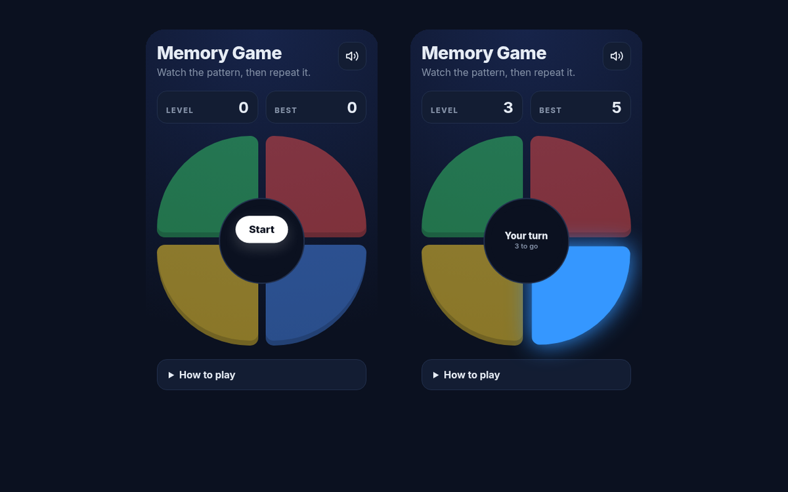

# Memory Game

Each round, one new pad lights up. Tap the whole pattern from the beginning, in order: only the newest pad is shown, so the rest comes from your memory. How far can you go?

**[Play it](https://henrykc24.github.io/simon-game/)**

## How to play

- Press **Start**. One pad lights up: tap it.
- Next round, another pad lights up (it can be the same one again). Tap the first pad, then the new one.
- Each round adds one pad, and only the new one is shown. One wrong pad ends the game.
- On a keyboard: Q, W, A and S for the four pads; Space or Enter to start.
- Your best score is kept in your browser. Sound can be turned off.

## Built with

HTML, CSS and JavaScript, no libraries. Works on phones and desktops.

## Author

**Henry KC Eze** · [Website](https://henrykc24.github.io/my-portfolio/) · [GitHub](https://github.com/HENRYKC24) · [LinkedIn](https://linkedin.com/in/henry-kc)

## License

[MIT](./LICENSE)
